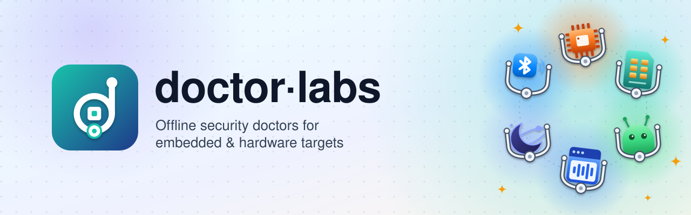
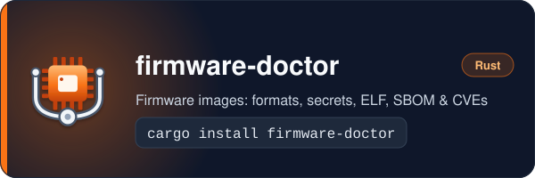
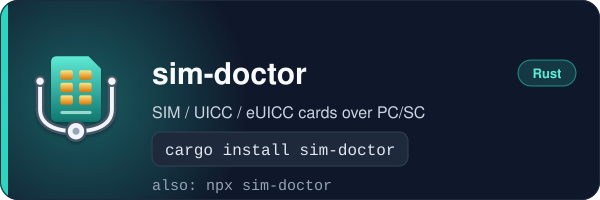
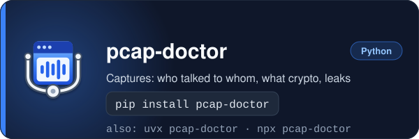
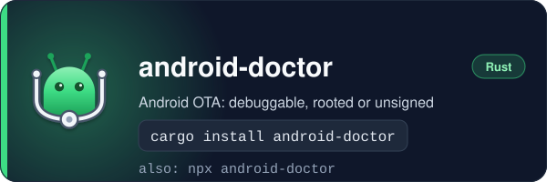
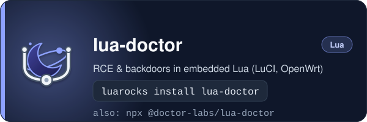
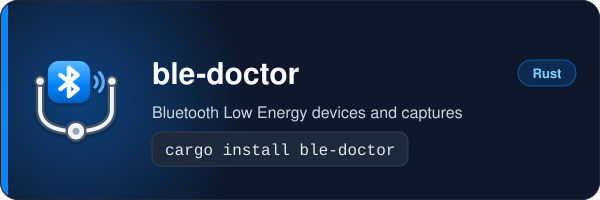
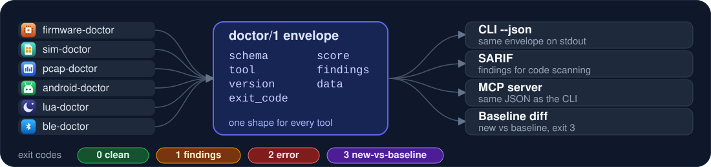

<picture>
  <source media="(prefers-color-scheme: dark)" srcset="assets/hero-dark.svg">
  
</picture>

<h1 align="center">Six offline doctors. One contract.</h1>

<p align="center"><b>Security checkers for firmware, SIM cards, packet captures, Android images, embedded Lua and Bluetooth LE.</b><br>
Each tool answers one question about one kind of artifact, runs without network or telemetry, and speaks the same machine contract, so agents and CI read every result the same way.</p>

## Why doctors

| <br>**Offline, no telemetry** | <br>**Evidence for every finding** | <br>**One shared contract** |
|:---:|:---:|:---:|
| Runs without network or telemetry. Nothing phones home. | Every finding points at the evidence behind it, so you can check the claim yourself. | One `doctor/1` envelope for every tool, so agents and CI read them all the same way. |

## Tools

[](https://github.com/doctor-labs/firmware-doctor) [](https://github.com/doctor-labs/sim-doctor) [](https://github.com/doctor-labs/pcap-doctor) [](https://github.com/doctor-labs/android-doctor) [](https://github.com/doctor-labs/lua-doctor) [](https://github.com/doctor-labs/ble-doctor)

## The contract: `doctor/1`

<p align="center"></p>

Every tool's `--json` emits the same envelope (`{schema, tool, version, exit_code, score, findings, data}`) with a 0-100 health score (`good` / `needs work` / `critical`), stable finding fingerprints, SARIF output, baseline diffing, and an MCP server that returns the same JSON as the CLI. The shared types live in [doctor-core](https://github.com/doctor-labs/doctor-core); each tool keeps its own score formula.

| exit code | meaning |
|:---:|:---|
| `0` | clean |
| `1` | findings |
| `2` | error |
| `3` | new-vs-baseline |

## Libraries

| <br>[**doctor-core**](https://github.com/doctor-labs/doctor-core) | <br>[**doctor-kit**](https://github.com/doctor-labs/doctor-kit) | <br>[**doctor-template**](https://github.com/doctor-labs/doctor-template) |
|:---|:---|:---|
| The shared `doctor/1` types: `Envelope`, `Finding`, `Severity`, `sanitize`, `fingerprint`, SARIF builder. | Skeleton library for building a new doctor CLI (`scan`, `shell`, `explore`, `mcp`, `fix`, `install`). | `cargo-generate` template for a new doctor on doctor-kit. |

```sh
cargo add doctor-core
cargo add doctor-kit
cargo generate --git https://github.com/doctor-labs/doctor-template template --name foo-doctor
```

## Get started

One install per tool. Every tool takes `--json` for the `doctor/1` envelope.

```sh
cargo install firmware-doctor   # firmware images
cargo install sim-doctor        # SIM / UICC / eUICC over PC/SC
pip install pcap-doctor         # packet captures
cargo install android-doctor    # Android OTA and firmware
luarocks install lua-doctor     # embedded Lua (LuCI / OpenWrt / CGI)
cargo install ble-doctor        # Bluetooth Low Energy
```

<p align="center"><sub>Defensive / CTF / own-gear use. No telemetry. Secrets found are reported, never repeated.</sub></p>
