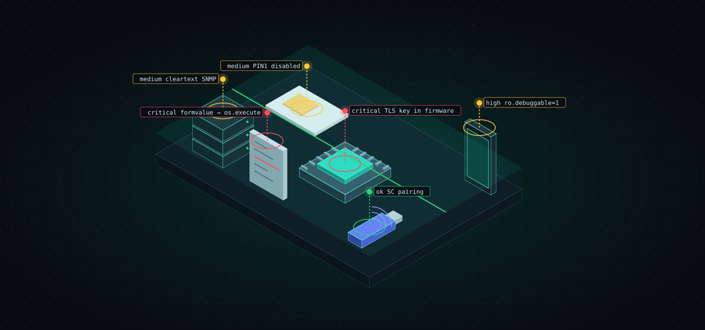

<h1> doctor·labs</h1>

Offline security **doctors** for embedded and hardware targets. Each tool answers one
question about one kind of artifact, runs without network or telemetry, points every
finding at evidence, and speaks one shared machine contract (`doctor/1`) so agents and
CI can read them all the same way.

| tool | examines | install |
|------|----------|---------|
|  [**sim-doctor**](https://github.com/doctor-labs/sim-doctor) | SIM / UICC / eUICC cards over PC/SC (Rust) | `cargo install sim-doctor` · `npx sim-doctor` |
|  [**pcap-doctor**](https://github.com/doctor-labs/pcap-doctor) | `.pcap`/`.pcapng` captures: who talked to whom, what crypto, what leaks (Python + tshark) | `pip install pcap-doctor` · `uvx pcap-doctor` · `npx pcap-doctor` |
|  [**android-doctor**](https://github.com/doctor-labs/android-doctor) | Android OTA / firmware images: debuggable, rooted or unsigned builds (Rust) | `cargo install android-doctor` · `npx android-doctor` |
|  [**lua-doctor**](https://github.com/doctor-labs/lua-doctor) | RCE and backdoors in embedded Lua (LuCI / OpenWrt / CGI) (Lua) | `luarocks install lua-doctor` · `npx @doctor-labs/lua-doctor` |
|  [**ble-doctor**](https://github.com/doctor-labs/ble-doctor) | Bluetooth Low Energy devices and captures (Rust) | `cargo install ble-doctor` |
| [**doctor-core**](https://github.com/doctor-labs/doctor-core) | the shared `doctor/1` types: `Envelope`, `Finding`, `Severity`, `sanitize`, `fingerprint`, SARIF builder | `cargo add doctor-core` |
|  [**doctor-kit**](https://github.com/doctor-labs/doctor-kit) | skeleton library for building a new doctor CLI (`scan`, `shell`, `explore`, `mcp`, `fix`, `install`) | git, crates.io soon |
| [**doctor-template**](https://github.com/doctor-labs/doctor-template) | `cargo-generate` template for a new doctor on doctor-kit | `cargo generate --git https://github.com/doctor-labs/doctor-template template --name foo-doctor` |

## The contract

Every tool's `--json` emits the same envelope (`{schema, tool, version, exit_code, score, findings, data}`)
with a 0-100 health score (`good` / `needs work` / `critical`), stable finding fingerprints,
SARIF output, baseline diffing, and an MCP server that returns the same JSON as the CLI.
Exit codes are uniform: `0` clean, `1` findings, `2` error, `3` new-vs-baseline.
The shared types live in [doctor-core](https://github.com/doctor-labs/doctor-core); each tool keeps its own score formula.

Defensive / CTF / own-gear use. No telemetry. Secrets found are reported, never repeated.
